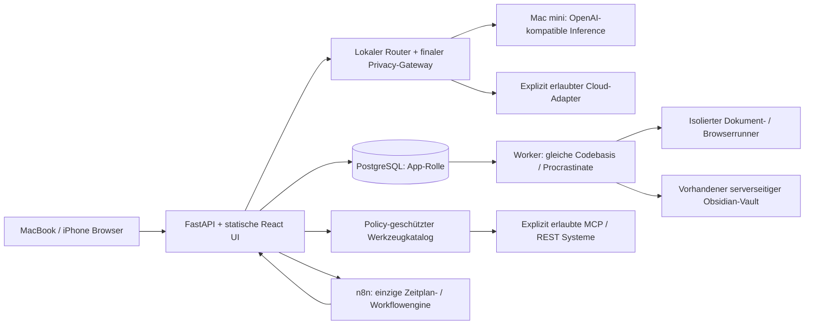

# Architektur und Entscheidungen

## Modularer Monolith

Keine generischen Agents als eigene Dienste, kein Next.js-Server, kein Redis,
kein neuer Inference-Gateway und kein zweiter Cron. Procrastinate ist eine etablierte
PostgreSQL-Queue für App-Jobs, keine zusätzliche Workflowengine. Periodische
Procrastinate-Jobs beschränken sich auf interne Memory-Indexpflege; wiederkehrende
Benutzeraufgaben terminiert weiterhin n8n. Es entsteht keine zweite Benutzer-Zeitplanengine.
Die optionale lokale Memory-Vektorsuche speichert begrenzte JSON-Vektoren in derselben
App-Datenbank; pgvector ist nicht erforderlich und wird nicht installiert.
React wird von FastAPI statisch ausgeliefert; Chat-SSE bleibt im App-Pfad.

## Kritische Vereinfachungen
- Vorhandenes n8n zunächst nur inventarisieren und über dokumentierte API anbinden.
  Keine parallele neue Instanz. Migration auf die Ziel-VM ist vor M5 zu entscheiden,
  damit dort auch Hintergrundprozesse laufen; bestehende Workflows bleiben erhalten.
- Syncthing bleibt alleiniger Vault-Sync. Kein neuer Sync-Dienst. App-Reconciliation
  verwaltet nur Dateien/Revisionen im autorisierten Memory-Bereich.
- Deterministische lokale Artefaktbearbeitung von generativer Bildarbeit trennen.
- Standardschnittstellen nicht als Nachweis von Tool-/Schemaunterstützung behandeln.
- V1 beginnt mit LOCAL_ONLY. Frühere Plattform-Cloudfreigaben werden nicht übernommen.

## Ressourcen / Deploymententscheidung
Ziel: separate stabile Debian-13-Linux-VM gegenüber dem Inference-Mac. Ob die
vorhandene ai-core-VM zusätzlich oder eine neue dedizierte VM verwendet wird, ist
noch zur Auswahl offen; keine neue VM wird allein aus dem Begriff separat abgeleitet. Startannahme: 4 vCPU, 8 GiB RAM, 80 GiB Datenträger,
ein Batchjob und eine lokale Inference gleichzeitig. Kein GPU-Bedarf. Diese Werte
sind noch nicht gemessen; M5 misst Chatlatenz, Runner-Spitzen und parallele Jobs.
Bestehende ai-core-Dienste sind Rückfallbetrieb und keine automatische
Installationsfreigabe. Bei Wiederverwendung bleiben ihre Ports/Netze/Volumes unverändert.
Proxmox-Kapazität und neue VM-ID/Adresse vor Provisionierung prüfen und freigeben.
App und n8n haben getrennte DBs, Rollen, Schlüssel und Migrationen. n8n bekommt
keinen direkten App-DB-Zugriff. Runner erhält weder Providersecrets noch Docker-Socket.

## Modellunabhängiges Gedächtnis — Ausbau vom 21.10.2026

Das Gedächtnis gehört der Anwendung. `Memory` und `MemoryRevision` bleiben der
gemeinsame Speichervertrag; der vorhandene PostgreSQL-/SQLAlchemy-Pfad wird
erweitert, keine zweite Memory-Datenbank eingeführt. `storage="vault"` bezeichnet
unveränderte kanonische Markdown-Notizen im bestehenden Obsidian-Vault.
`storage="app"` bezeichnet native Einträge ohne Vault-Abhängigkeit. Der vorhandene
Profil-Singleton bleibt ein eigener, manuell gepflegter Kontext mit feldweiser
Cloudfreigabe. Automatisches Lernen kopiert oder überschreibt ihn nicht. Auch
manuell gewählte typisierte Antwortpräferenzen behalten ihre Autorität; eine
gelernte Stilvorliebe wird nicht zur gleichrangigen Systemvorgabe.

### Lebenszyklus, Herkunft und Berechtigungen

Native Einträge enthalten Kategorie, Faktentyp, Status, Revision/Hash,
Gültigkeitszeitraum, Herkunft und einzelne freigegebene Provider. Persönliche,
Projekt-, Gesprächs- und Präferenzerinnerungen bleiben unterscheidbar. Eine Aussage
über einen Plan oder eine Hypothese ersetzt keinen bestätigten Fakt.
Inhaltsduplikate mit abweichendem Faktentyp oder anderen Freigaben erzeugen einen
Bearbeitungskonflikt; sie übernehmen keine früheren Cloudrechte. Eindeutige
Korrekturen können frühere Werte derselben Faktengruppe ersetzen. Mehrdeutige
Widersprüche bleiben Vorschläge zur Prüfung.

Gelernte Inhalte benötigen wörtliche eigene Nutzeraussagen. Nachrichten-ID,
Revision, Gespräch und Hash werden vor und nach der lokalen Verarbeitung erneut
geprüft. Besonders sensible Vorschläge speichern zunächst ausschließlich Pointer,
Quote-Offsets und feste Metadaten: kein zweiter persistierter Rohtext im
Vorschlagsspeicher. Vorschau und Freigabe rekonstruieren den Text aus der noch
aktuellen Quelle. Geänderte, deaktivierte oder archivierte Quellen erlauben keine
Übernahme. Quelleninhalte und Erinnerungen bleiben unvertrauenswürdiger Kontext,
keine Systemanweisungen oder zusätzlichen Werkzeugrechte.

Private Erinnerung ist der Standard. Eine Cloudfreigabe ist an den konkret
ausgewählten Provider und die aktuelle Revision gebunden. Der normale Auto-Modus
erteilt diese Freigabe nicht. Die finale Kontextprojektion prüft Eigentümer,
Scope, Quelle, Gültigkeit, Settings und Revision erneut am Providerübergang;
Änderungen während der Verarbeitung werden berücksichtigt. Gesprächsauszüge bleiben
`LOCAL_ONLY`. Relevantes privates Gedächtnis hält eine Auto-Antwort lokal;
explizites Cloud lässt nicht freigegebene Erinnerungen aus. Memorytexte fließen
nicht implizit in öffentliche Suchanfragen ein.

Explizites Vergessen nativer Einträge entfernt deren Text, Memory-Versionstexte
und Embeddingderivate. Zusammenfassungen werden invalidiert; Quellenpointer und
ein Einweg-Hash verhindern das erneute Lernen aus der alten Quelle. Die Original-
nachricht sowie bereits gespeicherte Chatantworten, historische Run-Snapshots,
Vault-Originale und externe Sicherungen werden dadurch nicht vollständig gelöscht.
Vault-Löschungen behalten ihren bisherigen wiederherstellbaren Archivvertrag.
Vergessen ist deshalb keine Zusage eines systemweiten rückwirkenden Datenpurges.

### Lernen und Kontextauswahl

`memory_settings.py` bietet revisionierte Einstellungen; die Oberfläche wählt ein
aktiviertes lokales Lernmodell unabhängig vom Antwortmodell. Lernen und Nutzung
sind separat schaltbar, alle Vorschläge können optional vorab geprüft werden.
Sensitive Prüfung lässt sich nicht abschalten. Der billige Aufnahmefilter lehnt
gewöhnliche Fragen, Begrüßungen, zitierte Dokumente und hypothetische Beispiele
vor einer Inferenz ab. Der konservative direkte Aussagefilter ist keine allgemeine
semantische Extraktion beliebiger Gesprächsinhalte. E-Mail-/Archivbelege und
Modellantworten werden nicht automatisch zu persönlichen Fakten.

`memory_learning.py` prüft vor dem Modellaufruf eine kleine geschlossene Grammatik
vollständiger eigener Familienaussagen: Name, Alter und Reitfähigkeit einer Tochter
oder eines Sohns. Hinzu kommen vollständige eigene Berufsangaben nach
„Ich arbeite [jetzt|inzwischen] als …“ mit begrenzten Rollenwörtern; Pläne,
Qualifikationen, Fragen und zusammengesetzte Aussagen werden nicht so gedeutet.
Reitdauer unterstützt Ziffern und deutsche Zahlwörter von eins
bis zwölf. Nur exakt passende vollständige Aussagen werden deterministisch als
wörtlich belegte Fakten verarbeitet; Fragen, unsichere Formulierungen und fremde
Quellen erhalten dadurch keine Sonderfreigabe. Diese strukturelle Prüfung ist
ein eigener Aufnahmeweg und keine nachträgliche Erhöhung einer Modellkonfidenz.
Eine belegte aktuelle explizite Vault-Speicherung derselben Nachricht verhindert
ein zusätzliches automatisches App-Memory. Dafür werden Server-Ursprung, Scope,
Revision/Inhalt und die kanonische Datei geprüft.
Andere zugelassene Aussagen verwenden den konfigurierten begrenzten lokalen
JSON-Schema-Aufruf; jedes Ergebnis wird zusätzlich gegen den unveränderten
Originaltext geprüft. Sensible Prüfung, Quellenbindung und Privacy gelten für
beide Wege unverändert. Der
bestehende Procrastinate-Worker verarbeitet die Jobs nachrangig; der Chat wartet
nicht auf diesen separaten Modellaufruf. Durable Jobs besitzen einen Queued-only-
Claim, Einstellungen-/Quellenbindung und keine blinden Wiederholungen nach
unsicherer Ausführung. Fehlendes lokales Modell erzeugt keine erfundenen Fakten
und keinen Cloudfallback. SQLite dient weiterhin Entwicklung und Vertragstests.

`memory_retrieval.py` ergänzt den vorhandenen RAG-/`ContextPart`-Pfad um strukturierte
Felder, lexikalische Relevanz und optional lokale Vektorähnlichkeit. Die Auswahl ist
auf höchstens 2.000 Kandidaten begrenzt; Scope, aktive Revision und Gültigkeit
werden zusätzlich geprüft. Konfigurierbare Mengen- und Kontextbudgets werden durch
die tatsächliche Chat-/Modellkapazität weiter begrenzt. Bei fehlender oder
fehlerhafter Embeddingkonfiguration bleibt der strukturierte/lexikalische Pfad
verfügbar. Vektoren sind abgeleiteter Cache mit Memory-Revision, Inhalts-Hash und
Modell-/Konfigurationsbindung, keine weitere Wissensquelle.

Interne periodische Indexpflege (`hub.memory-index`) verarbeitet höchstens 20
fehlende oder veraltete Einträge pro Minute, einschließlich manueller Änderungen.
Sie verwendet die bestehende nachrangige Memory-Queue und einen Queueing-Lock;
sie installiert weder einen eigenen Dienst noch eine neue Datenbank oder pgvector.

`memory_summary.py` erzeugt unabhängig von einer erfolgreichen Faktenextraktion
lokale **extraktive Gesprächsauszüge**. Bei mindestens zwölf aktiven Nachrichten
wird ein Fenster von höchstens 100 Nachrichten betrachtet; die neuesten acht
bleiben der aktuellen Gesprächshistorie vorbehalten. Ältere Ausschnitte besitzen
Quellenpointer, Revisions-/Hashprüfung und einen begrenzten Umfang. Entscheidungen
und Pläne können priorisiert werden, bleiben aber als unvollständige wörtliche
Auszüge gekennzeichnet. Das ist weder eine vollständige Langzeitrekonstruktion
noch eine neue Faktenbestätigung.

### Migration und Abnahmegrenze

Migration `0046_intelligent_memory.py` ist additiv: zusätzliche Metadaten an
`memories`, sowie Settings, Pointer-Vorschläge, Lernjobs, Embeddings und
Gesprächsauszüge in derselben Datenbank. Altbestand erhält `vault`/`owner`/`active`
als Standardwerte; bestehende Inhalte, Profilangaben, Revisionen und Privacy-Labels
werden nicht neu geschrieben. Ein Downgrade verweigert das Entfernen bei nativen
Erinnerungen oder vorhandenen neuen Zustandsdaten. Vor einem Rollout bleiben
aktuelle Sicherung und Prüfung des konkreten Zielstands erforderlich; eine
erfolgreiche additive Migration oder Sicherung ist kein Wiederherstellungsnachweis.

Gezielte synthetische Unit-, API-, Browser- und Migrationsprüfungen belegen die
einzelnen Verträge. Der Zwischenstand `b8189bb` bestand die lokale Gesamtsuite
mit 2.640 Tests einschließlich PostgreSQL; seine exakte GitHub-CI ist noch offen.
Eine isolierte Prüfung gegen das reale lokale Modell der VM belegt synthetische
Berufsangabe, Korrektur und sensible Pointer sowie Persistenz nach Neuöffnung,
Abruf und Vergessen. Eine Familien-Reitaussage wurde vom kleinen Modell dagegen
nicht zuverlässig extrahiert; daraus folgt der enge deterministische Aufnahmeweg,
keine allgemeine Qualitätszusage. Die nachfolgende Korrektur benötigt neue passende
Checks. Schema-0046-Rollout, echter HTTP-Chat-Lernablauf der Anwendung und ein
reales optionales Embeddingmodell sind weiterhin getrennte offene Nachweise.
Den verbindlichen aktuellen Stand führt `STATUS.md`.
