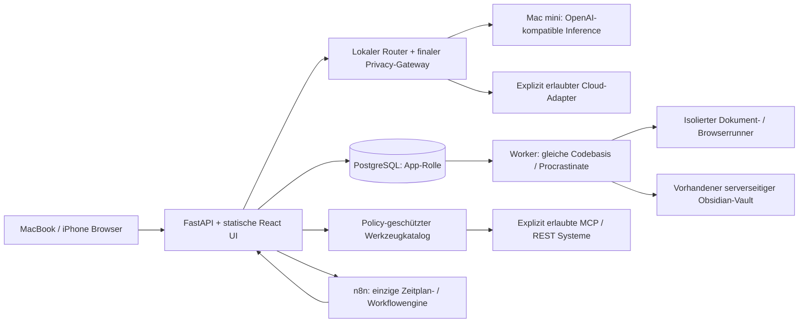

# Architektur und Entscheidungen

## Modularer Monolith

Keine generischen Agents als eigene Dienste, kein Next.js-Server, kein Redis,
kein neuer Inference-Gateway und kein zweiter Cron. Procrastinate ist eine etablierte
PostgreSQL-Queue für App-Jobs, keine zusätzliche Workflowengine. Ihre periodischen
Scheduler-Funktionen werden nicht verwendet. n8n terminiert wiederkehrende Aufgaben.
pgvector erst bei gemessenem Bedarf und geprüftem lokalem Embedding-Modell.
React wird von FastAPI statisch ausgeliefert; Chat-SSE bleibt im App-Pfad.

## Kritische Vereinfachungen
- Vorhandenes n8n zunächst nur inventarisieren und über dokumentierte API anbinden.
  Keine parallele neue Instanz. Migration auf die Ziel-VM ist vor M5 zu entscheiden,
  damit dort auch Hintergrundprozesse laufen; bestehende Workflows bleiben erhalten.
- Syncthing bleibt alleiniger Vault-Sync. Kein neuer Sync-Dienst. App-Reconciliation
  verwaltet nur Dateien/Revisionen im autorisierten Memory-Bereich.
- Deterministische lokale Artefaktbearbeitung von generativer Bildarbeit trennen.
- Standardschnittstellen nicht als Nachweis von Tool-/Schemaunterstützung behandeln.
- V1 beginnt mit LOCAL_ONLY. Frühere Plattform-Cloudfreigaben werden nicht übernommen.

## Ressourcen / Deploymententscheidung
Ziel: separate stabile Debian-13-Linux-VM gegenüber dem Inference-Mac. Ob die
vorhandene ai-core-VM zusätzlich oder eine neue dedizierte VM verwendet wird, ist
noch zur Auswahl offen; keine neue VM wird allein aus dem Begriff separat abgeleitet. Startannahme: 4 vCPU, 8 GiB RAM, 80 GiB Datenträger,
ein Batchjob und eine lokale Inference gleichzeitig. Kein GPU-Bedarf. Diese Werte
sind noch nicht gemessen; M5 misst Chatlatenz, Runner-Spitzen und parallele Jobs.
Bestehende ai-core-Dienste sind Rückfallbetrieb und keine automatische
Installationsfreigabe. Bei Wiederverwendung bleiben ihre Ports/Netze/Volumes unverändert.
Proxmox-Kapazität und neue VM-ID/Adresse vor Provisionierung prüfen und freigeben.
App und n8n haben getrennte DBs, Rollen, Schlüssel und Migrationen. n8n bekommt
keinen direkten App-DB-Zugriff. Runner erhält weder Providersecrets noch Docker-Socket.
